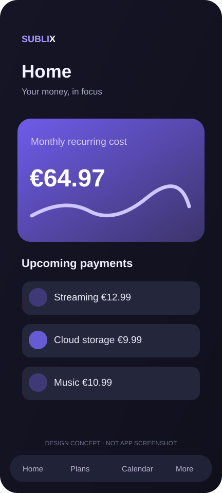
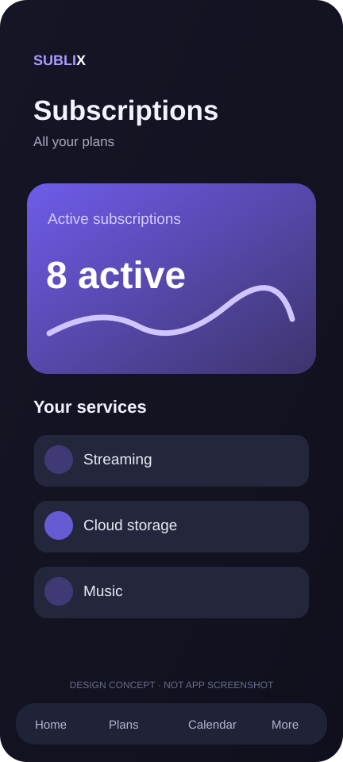
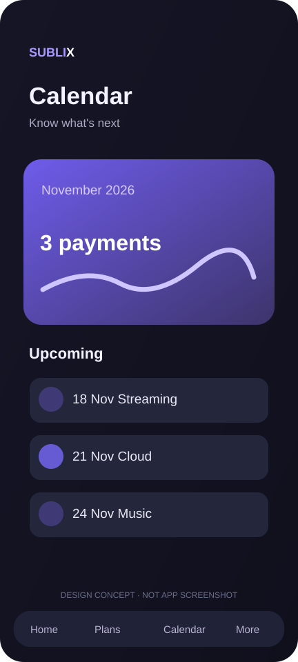
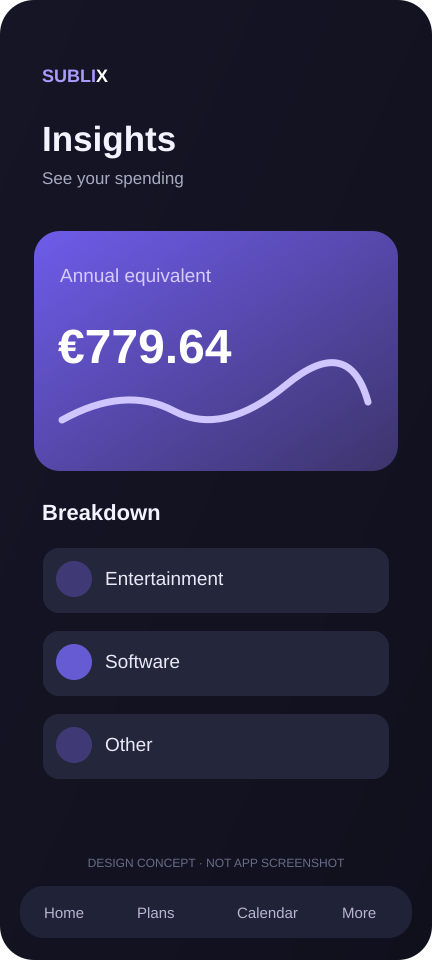

<div align="center">


# SubliX

### Every subscription. Under control.

**Private · Offline-first · No account · Free & Pro Android editions**

[](app/) [](docs/RELEASE.md) [](https://brendigo.com)

Manage recurring expenses, anticipate renewals, and understand your subscription budget. No accounts or financial account access.

</div>

## Designed around clarity

| Home | Subscriptions | Calendar | Insights |
|:---:|:---:|:---:|:---:|
|  |  |  |  |

> **Design concepts:** The illustrations above are vector mockups, **not actual Android screenshots**. Implementation and validation status is documented below.

## Why SubliX?

- **Know before you're charged.** See upcoming renewals and optionally enable local reminders.
- **Stay private.** No account, bank integration, email scanning, cloud storage or required backend.
- **See the real picture.** Recurring monthly equivalent is separate from upcoming scheduled charges.
- **Two independent apps.** Free and Pro install separately; explicit data export/import is planned for switching.
- **English-first.** Responsive Material 3-inspired UI and dark-first visual system.

## Editions

| Capability | Free | Pro |
| --- | :---: | :---: |
| Track subscriptions | ✓ | ✓ |
| Recurring-cost dashboard | ✓ | ✓ |
| Local data storage | ✓ | ✓ |
| Upcoming payments | ✓ | ✓ |
| Advanced budgeting & savings | — | Included (preview) |
| Advanced export & device lock (roadmap) | — | Planned |

The Pro flavor is a **separate application**, not an in-app purchase. Publishing a Pro APK in a public Release allows it to be installed for free; monetization would instead require paid distribution or a different entitlement model.

## Project layout

```text
app/                   Android app, Free and Pro product flavors
web/                   Static, no-account marketing site
brending/              Logos, edition icons, and 20 screen concepts
docs/                  Screen specs, security, release process
.github/workflows/     Android CI and publishing workflow
```

## Build

Prerequisites: Android SDK 36, JDK 17, Gradle 8.13 or Android Studio with supported AGP.

```bash
gradle :app:assembleFreeDebug :app:assembleProDebug
gradle :app:bundleFreeRelease :app:bundleProRelease
```

The two application IDs are `com.brendigo.sublix.free` and `com.brendigo.sublix.pro`. For **production signed** APK/AAB artifacts, configure signing secrets and follow [release instructions](docs/RELEASE.md). Never publish locally generated private keys or passwords in this repo.

## Website

`web/` is a standalone responsive static site. No user login, account forms, database, cookies for tracking, or analytics SDKs. The demo illustrations are clearly labeled. Stored solely as source code in this GitHub repository; **no GitHub Pages deployment**.

## Actual app screenshots

The development workflow captures **genuine PNG screenshots of the running Android emulator**, using synthetic data in a debug-only fixture. The current SVG illustrations above are explicitly concepts and will be replaced automatically in this README **only after real captures exist and pass validation**.

See [screenshot pipeline](docs/SCREENSHOTS.md). Final 1:1 fidelity needs measurement against all design references, and all 20 mapped screens are being implemented, and exact visual parity remains unverified.

## Project status

This repository is being developed in stages. Concept artwork does not imply that all 20 screens or every advertised roadmap feature is already implemented. CI builds and tests are the source of truth for build readiness. Check Pull Requests and Releases for verified outcomes.

## Privacy · Licensing

See [Privacy](web/privacy.html), [Security](docs/SECURITY.md), and the root [MIT License](LICENSE). SubliX brand and visual assets are by **BRENDIGO** · [brendigo.com](https://brendigo.com).
